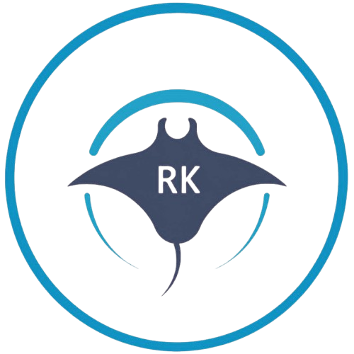

  

<h1 align="center">RKREEF · Mořská akvária RK</h1>

  Mořská akvária na míru – návrh, výroba, montáž a servis po celé ČR. 
  <a href="https://rkreef.eu">rkreef.eu</a> · +420 735 548 756

---

## Co děláme

- **Mořská akvária na míru:** navrhneme, vyrobíme, dovezeme, zapojíme a předáme živé akvárium.
- **Vlastní přepadový systém**, chráněný užitným vzorem č. 38266.
- **Servis a havárie 24/7:** pomoc při poruše, péče o akvárium, ustájení zvířat.
- **Kurzy jeden na jednoho**, kde se naučíte o mořské akvárium starat sami.
- **E-shop** s technikou, chemií a vybavením pro mořskou akvaristiku: [rkreef.eu/eshop](https://rkreef.eu/eshop/)

## Software a firmware – vlastní vývoj

Elektroniku, firmware i aplikace si vyvíjíme sami. Zdrojový kód je zatím soukromý.

**RK LIGHT** (připravujeme): LED osvětlení mořského akvária
- **Firmware** pro ESP32-C3 (C++, PlatformIO, NimBLE): vícekanálové řízení LED, denní program s plynulým svítáním a stmíváním, měsíční světlo, efekty mraků a bouřky, aklimatizace korálů na nové světlo, teplotní ochrana s řízením ventilátoru, nastavení Wi-Fi přes Bluetooth, zabezpečené spárování světla s majitelem a aktualizace přes OTA.
- **Mobilní aplikace** (Flutter, Firebase): ovládání jednoho světla i celého akvária naráz, rozvrhy a presety, ovládání na dálku, zálohy nastavení v cloudu a notifikace. Teď běží uzavřený test na Google Play.

**Reef Control** (připravujeme): řídicí systém akvária
- Firmware řídicí jednotky (C) a klientská aplikace (Flutter).

**rkreef.eu**: web a e-shop
- Firebase Hosting, Firestore a Cloud Functions (Node.js).
- Vlastní pokladna, napojení na DPD, automatická synchronizace skladu a cen, faktury, věrnostní program, konfigurátor akvária a komunitní fórum.

  
  
  
  
  
  
  

## Kontakt

| | |
|---|---|
| Web | [rkreef.eu](https://rkreef.eu) |
| Telefon | +420 735 548 756 |
| E-mail | radekkrs@gmail.com |
| Instagram | [@morska_akvaria_rk](https://www.instagram.com/morska_akvaria_rk/) |
| TikTok | [@rkreef](https://www.tiktok.com/@rkreef) |
| Facebook | [Mořská akvária RK](https://www.facebook.com/profile.php?id=100016105538040) |
| YouTube | [@Morska-Akvaria](https://www.youtube.com/@Morska-Akvaria) |

Radek Kraus · IČO 19068085 · Šimonovice u Liberce
